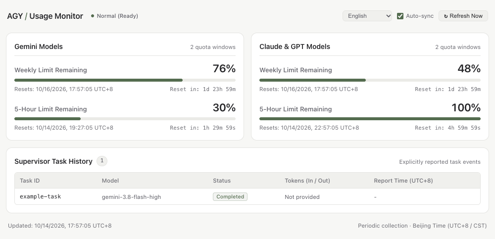

<p align="center">
  
</p>

[简体中文](README.md) · **English**

**View Antigravity quota, reset times, and Supervisor task records in an embedded Codex panel.**

Quota comes from the local `agy /usage` command. The panel follows the host's light or dark theme, and token statistics show only the counts actually provided by the upstream tools.

**Node.js 24+** · **Validated on macOS** · [MIT License](LICENSE)

[Quick start](#quick-start) · [Tasks and tokens](#tasks-and-tokens) · [MCP tools](#mcp-tools) · [Development and verification](#development-and-verification)

<picture>
  <source media="(max-width: 600px) and (prefers-color-scheme: dark)" srcset="./assets/readme/panel-mobile-dark-en.png">
  <source media="(max-width: 600px)" srcset="./assets/readme/panel-mobile-light-en.png">
  <source media="(prefers-color-scheme: dark)" srcset="./assets/readme/panel-dark-en.png">
  <source media="(prefers-color-scheme: light)" srcset="./assets/readme/panel-light-en.png">
  
</picture>

> Browser-rendered previews of the panel component using sample data. These are not screenshots of the Codex window or the current account's quota.

## Usage at a glance

- **Two quota windows**: remaining weekly and five-hour percentages grouped by model, with reset times in Beijing time (UTC+8) and countdowns.
- **Embedded GUI**: loads inside Codex through MCP Apps, with sidebar and chat panel entry points, narrow layouts, and light and dark themes.
- **Chinese and English**: choose **中文 / English** at the top of the panel to switch instantly. Your preference is saved when local storage is available; the initial language is selected automatically. Switching still works for the current panel if the host blocks storage.
- **Follow Codex**: the native panel can use the host's `hostContext.locale` and respond to language-change notifications. This optional field falls back to browser language when unavailable; manual Chinese/English overrides remain unchanged. New users start in follow mode, and existing users can select it at the top of the panel.
- **Accurate task records**: explicitly reported Supervisor states and input/output token counts. Missing counts appear as “未提供” (not provided); no values are fabricated.
- **Caching and recovery**: collects quota every 60 seconds and reads the cache every 5 seconds in the panel. Connection errors retain the last valid quota and mark it as stale.

## Quick start

You need **Node.js 24+**, an installed and authenticated **Antigravity CLI (`agy`)**, and a **Codex client with MCP Apps support**.

```bash
git clone https://github.com/PYFGDUF/agy-usage-dashboard.git
cd agy-usage-dashboard
npm ci --no-audit --no-fund

codex plugin marketplace add "$PWD"
codex plugin add agy-usage-dashboard@agy-usage-local
codex plugin list --json
```

After installation, open **AGY 用量** (AGY Usage) from the plugin entry in the Codex sidebar or **Plugins and MCPs** on the right side of the chat. If the entry is missing, reload the chat or restart the client and check that the plugin is enabled.

The plugin also registers the `agy-usage` skill. Agents use the embedded panel by default, check quota before delegating work, and explicitly record task start and end states.

<details>
<summary>MCP-only setup or browser debugging</summary>

To register only the MCP server, replace these placeholders with the actual absolute paths:

```bash
codex mcp add agy-usage -- "<absolute-path-to-node>" "<absolute-project-path>/src/mcp/server.js"
```

For other MCP clients:

```json
{
  "mcpServers": {
    "agy-usage": {
      "command": "node",
      "args": ["<absolute-project-path>/src/mcp/server.js"],
      "env": { "AGY_USAGE_PORT": "8766" }
    }
  }
}
```

The browser is a development fallback: run `npm start` and visit `http://127.0.0.1:8766`. The embedded panel reads data through the host's MCP bridge and does not require opening that URL.

</details>

## How data reaches the panel

<p align="center">
  
</p>

`agy --print /usage --print-timeout 15s` supplies quota data. The local service parses and caches the result, and MCP tools deliver it to the embedded Codex component. Reading quota does not start a model conversation or estimate official quota from accumulated token counts.

## Tasks and tokens

Tasks are **explicitly reported** through `agy_supervisor_event` or `POST /api/tasks`. The plugin does not automatically enumerate background tasks from other bridges.

```json
{
  "id": "implementation-01",
  "model": "gemini-3.8-flash-high",
  "status": "completed",
  "usage": { "input_tokens": 3200, "output_tokens": 850 }
}
```

These numbers illustrate the reporting format only. The API accepts both `inputTokens` / `outputTokens` and `input_tokens` / `output_tokens`, and normalizes the stored fields. Values must be nonnegative integers; conflicting aliases are rejected.

When using [AGY Supervisor](https://github.com/crazyzhang277/codex-antigravity-bridge), extract the actual `usage` from the tool's structured result or JSON text before reporting it. Some asynchronous bridge results contain no counts; omit `usage` in that case. “Not provided” does not mean `0`, and missing historical values cannot be reconstructed without a recorded source. See the [agy-usage skill](skills/agy-usage/SKILL.md) for details (in Chinese).

If asynchronous tasks from an older AGY Bridge always show “Not provided”, see the optional [bridge patch and instructions](integrations/agy-bridge/README.md), verified with a real task.

## MCP tools

| Tool | Purpose |
| :--- | :--- |
| `agy_usage_panel` | Show the embedded panel and return quota status |
| `agy_usage_get` | Read quota; a forced refresh can be requested, subject to a cooldown |
| `agy_supervisor_event` | Record explicitly reported task states and exact token counts |
| `agy_dashboard_open` | Return the local URL for an explicitly requested browser fallback |

## Development and verification

```bash
npm run verify
```

Verification covers pinned dependencies, plugin and marketplace manifests, release files, unit and HTTP/MCP integration tests, embedded UI bridge regressions, and a stdio MCP smoke test. GitHub Actions runs the same checks on pushes and pull requests.

Source entry points: embedded component [panel.html](src/ui/panel.html) · MCP [server.js](src/mcp/server.js) · quota collector [collector.js](src/collector.js) · task records [task-store.js](src/task-store.js). The SDK is pinned to `@modelcontextprotocol/sdk@1.32.1`.

## Compatibility and security

- On macOS, automated checks, local installation, and quota reads through the real CLI have been verified, and quota display inside Codex has been confirmed. Windows and other host clients still require verification on actual installations.
- The service listens only on `127.0.0.1`, validates the Host header and the Origin of modifying requests, and should not be exposed to the public internet.
- The plugin does not store login credentials. An unauthenticated CLI, insufficient permissions, or a timeout produces an error or stale state in the panel.
- The embedded component is self-contained, with no external CDN or scripts. It reads data through host-provided MCP tool calls.
- `.runtime/`, logs, worktrees, dependencies, and common credential files are ignored by Git. Report security issues privately as described in [SECURITY.md](SECURITY.md).

## License

[MIT](LICENSE) © 2026 彭宇峰 (Peng Yufeng).

The optional AGY Bridge patch uses [Apache-2.0](integrations/agy-bridge/LICENSE).
