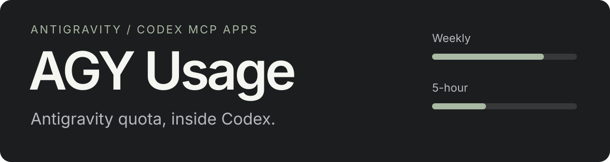
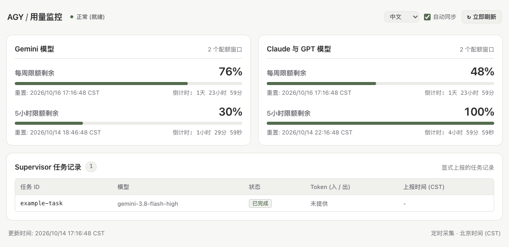
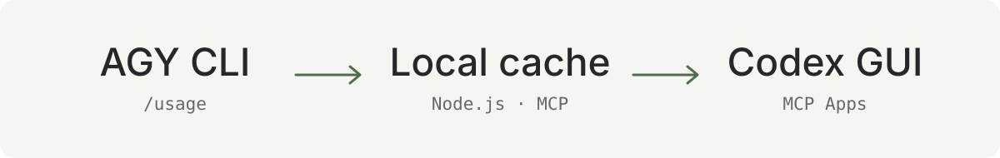

<p align="center">
  
</p>

**简体中文** · [English](README.en.md)

**在 Codex 原生面板中查看 Antigravity 配额、重置时间和 Supervisor 任务记录。**

无需切换到外部网页。配额来自本地 `agy /usage` 指令，界面跟随宿主深浅主题，Token 统计只显示上游实际提供的数值。

**Node.js 24+** · **macOS 已验证** · [MIT License](LICENSE)

[快速安装](#快速安装) · [任务与 Token](#任务与-token) · [MCP 工具](#mcp-工具) · [开发与验证](#开发与验证)

<picture>
  <source media="(max-width: 600px) and (prefers-color-scheme: dark)" srcset="./assets/readme/panel-mobile-dark.png">
  <source media="(max-width: 600px)" srcset="./assets/readme/panel-mobile-light.png">
  <source media="(prefers-color-scheme: dark)" srcset="./assets/readme/panel-dark.png">
  <source media="(prefers-color-scheme: light)" srcset="./assets/readme/panel-light.png">
  
</picture>

> 面板组件的浏览器渲染预览，使用示例数据；不是 Codex 窗口截图，也不代表当前账号配额。

## 一眼看到你关心的用量

- **两个配额窗口**：按模型分组查看每周、5 小时剩余百分比与北京时间重置倒计时。
- **原生 GUI**：通过 MCP Apps 加载在 Codex 中，支持侧栏和聊天面板入口，适应窄屏与深浅主题。
- **中英文切换**：在面板顶部选择「中文 / English」，即时切换并记住偏好；首次打开跟随浏览器语言。宿主限制本地存储时，仍可在当前面板中切换。
- **如实记录任务**：显式上报 Supervisor 状态与输入、输出 Token；未提供计数时显示“未提供”，不补造数字。
- **缓存与容错**：后台每 60 秒采集，面板每 5 秒读缓存；连接异常时保留上次有效配额并标记过期。

## 快速安装

需要 **Node.js 24+**、已安装并登录的 **Antigravity CLI（`agy`）**，以及支持 MCP Apps 的 **Codex 客户端**。

```bash
git clone https://github.com/PYFGDUF/agy-usage-dashboard.git
cd agy-usage-dashboard
npm ci --no-audit --no-fund

codex plugin marketplace add "$PWD"
codex plugin add agy-usage-dashboard@agy-usage-local
codex plugin list --json
```

安装后，在 Codex 左侧插件入口，或聊天右侧「插件与 MCP / Plugins and MCPs」中打开 **AGY 用量**。入口未出现时，重新加载聊天或重启客户端，并检查插件是否启用。

插件同时注册 `agy-usage` 技能：智能体会优先使用内嵌面板，在委派任务前查询配额，再显式记录任务起止状态。

<details>
<summary>仅接入 MCP，或使用浏览器调试</summary>

仅注册 MCP 服务：将下列占位符替换为实际绝对路径。

```bash
codex mcp add agy-usage -- "<Node绝对路径>" "<项目绝对路径>/src/mcp/server.js"
```

通用 MCP 客户端可使用：

```json
{
  "mcpServers": {
    "agy-usage": {
      "command": "node",
      "args": ["<项目绝对路径>/src/mcp/server.js"],
      "env": { "AGY_USAGE_PORT": "8766" }
    }
  }
}
```

浏览器仅作为开发回退：运行 `npm start`，访问 `http://127.0.0.1:8766`。原生面板通过宿主 MCP 桥接读取数据，不需要访问这个网址。

</details>

## 数据如何到达面板

<p align="center">
  
</p>

`agy --print /usage --print-timeout 15s` 提供配额数据，本地服务解析并缓存结果，MCP 工具把数据交给 Codex 原生组件。配额读取不发起模型对话，也不根据 Token 累加推算官方额度。

## 任务与 Token

任务来自 `agy_supervisor_event` 或 `POST /api/tasks` 的**显式上报**。插件不会自动枚举其他桥接器的后台任务。

```json
{
  "id": "implementation-01",
  "model": "gemini-3.8-flash-high",
  "status": "completed",
  "usage": { "input_tokens": 3200, "output_tokens": 850 }
}
```

以上数值仅为上报格式示例。接口兼容 `inputTokens` / `outputTokens` 与 `input_tokens` / `output_tokens`，存储时统一字段；数值必须是非负整数，冲突别名会被拒绝。

使用 [AGY Supervisor](https://github.com/crazyzhang277/codex-antigravity-bridge) 时，应从工具的结构化结果或 JSON 文本中提取真实 `usage` 后上报。部分异步桥接结果没有计数，此时应省略 `usage`；“未提供”不等于 `0`，历史缺失值也无法凭空恢复。详见 [agy-usage 技能](skills/agy-usage/SKILL.md)。

## MCP 工具

| 工具 | 用途 |
| :--- | :--- |
| `agy_usage_panel` | 展示内嵌面板，返回配额状态 |
| `agy_usage_get` | 读取配额；可请求强制刷新，受冷却限制 |
| `agy_supervisor_event` | 写入显式任务状态与精确 Token 统计 |
| `agy_dashboard_open` | 获取本地地址，仅用于明确请求的浏览器回退 |

## 开发与验证

```bash
npm run verify
```

综合校验包括依赖锁定、插件与 marketplace 清单、发布文件、单元与 HTTP/MCP 集成测试、原生 UI 桥接回归和 Stdio MCP 烟雾测试。GitHub Actions 会在 push 与 pull request 时运行相同校验。

源码入口：原生组件 [panel.html](src/ui/panel.html) · MCP [server.js](src/mcp/server.js) · 配额采集 [collector.js](src/collector.js) · 任务记录 [task-store.js](src/task-store.js)。SDK 精确锁定为 `@modelcontextprotocol/sdk@1.32.1`。

## 兼容性与安全边界

- macOS 上已完成自动化验证、本地安装和真实 CLI 配额读取，并确认配额可在 Codex 原生面板中展示。Windows 和其他宿主客户端仍需实机验证。
- 服务只监听 `127.0.0.1`，校验 Host 与修改请求的 Origin，不应暴露到公网。
- 插件不存储登录凭据；CLI 未登录、权限不足或超时时会如实显示错误或过期状态。
- 原生组件自包含，无外部 CDN 或脚本；通过宿主调用 MCP 工具获取数据。
- `.runtime/`、日志、工作树、依赖和常见凭据文件均被 Git 忽略。安全问题请按 [SECURITY.md](SECURITY.md) 私下报告。

## License

[MIT](LICENSE) © 2026 彭宇峰。
